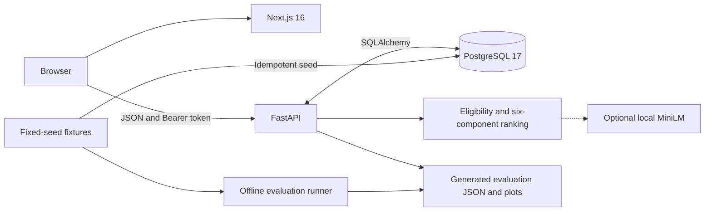
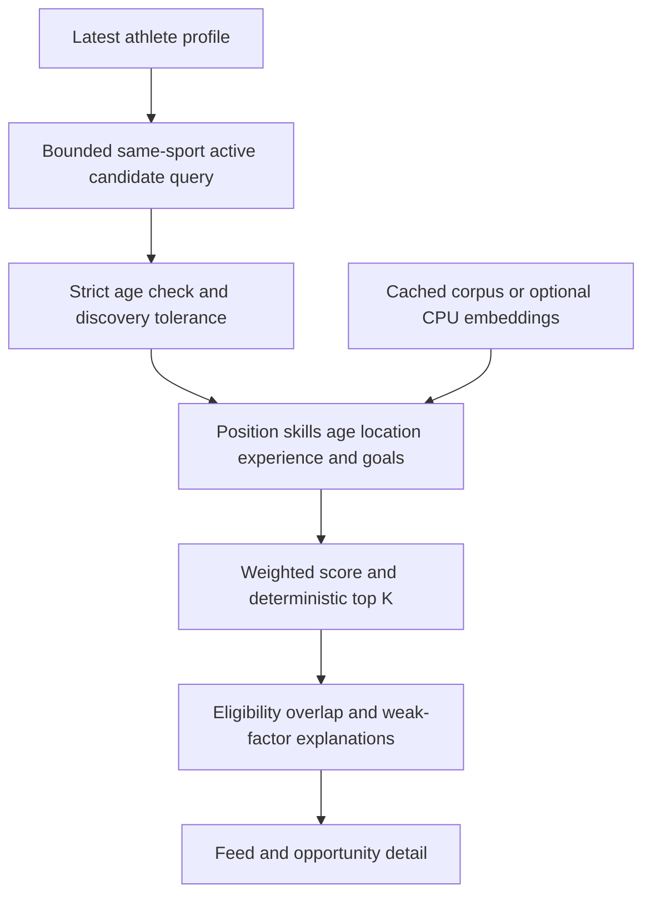

# Ground Up system architecture

Ground Up is a three-tier application. The existing Next.js 16 App Router renders the feed, onboarding and opportunity gallery. FastAPI validates JWTs, reads and writes PostgreSQL and calls the pure matcher. Docker Compose runs PostgreSQL and the API. The browser uses the Next.js server on the host during local development.

## Data and boundaries

| Entity | Role |
|---|---|
| User and Profile | A UUID-keyed account and optional profile. Synthetic users and organisation publishers are explicitly marked. |
| Opportunity | Posting requirements, deadline, age policy, synthetic flag and organisation owner |
| Application | Athlete and opportunity foreign keys, submitted status, created time and a unique athlete/posting pair |
| Post | Stored author, body and creation time |

Alembic creates and upgrades the schema before API readiness passes. Applications are created atomically through a PostgreSQL unique constraint. The organisation inbox joins through posting ownership. Demo sign-in is limited to seeded IDs and the explicit local environment. The browser’s proxy redirect is an optimistic check. FastAPI validates identity and role on protected requests.

The corpus covers active descriptions across the catalogue. The matcher reuses the same feature calculations in service requests and offline evaluation. Evaluation labels come from a separate decision tree. It uses a fixed timestamp, shared candidate pools and athlete-level bootstrap sampling. The live evaluation endpoint reads generated files and never trains or runs the experiment during page load.

## Deployment stages

| Stage | Components | Status |
|---|---|---|
| Local | Compose development image, PostgreSQL volume, Next.js on port 3000 | Default demonstration |
| Hosted prototype | Render runtime image, external PostgreSQL, Vercel Next.js, configured Google OAuth | Configuration retained. Requires hosting accounts and values. |
| Future scale | Container service, managed PostgreSQL, data and compute separation | Design only |

A larger installation can use ECS Fargate, Aurora PostgreSQL with RDS Proxy, Redis for cached recommendations, SQS for recomputation after profile/posting changes and S3 for media. pgvector can supply candidate retrieval before the same explainable scorer. Stage 2 load and availability targets in the historical architecture are design assumptions. Moving migrations to a one-off deployment job and using HttpOnly sessions on a shared domain remain future work.

[API contracts](docs/API_DOCUMENTATION.md) · [Setup](docs/SETUP.md) · [Matching and evaluation](docs/ML_METHODOLOGY.md)
