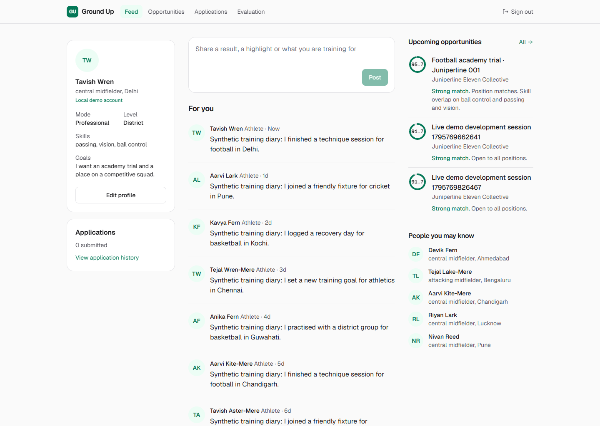
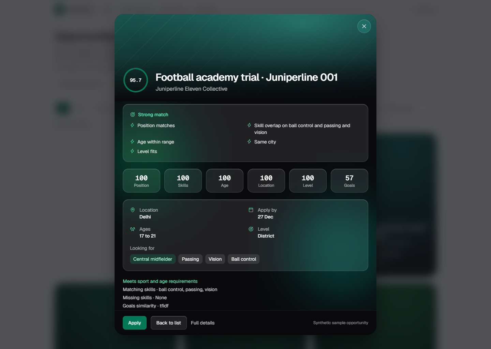
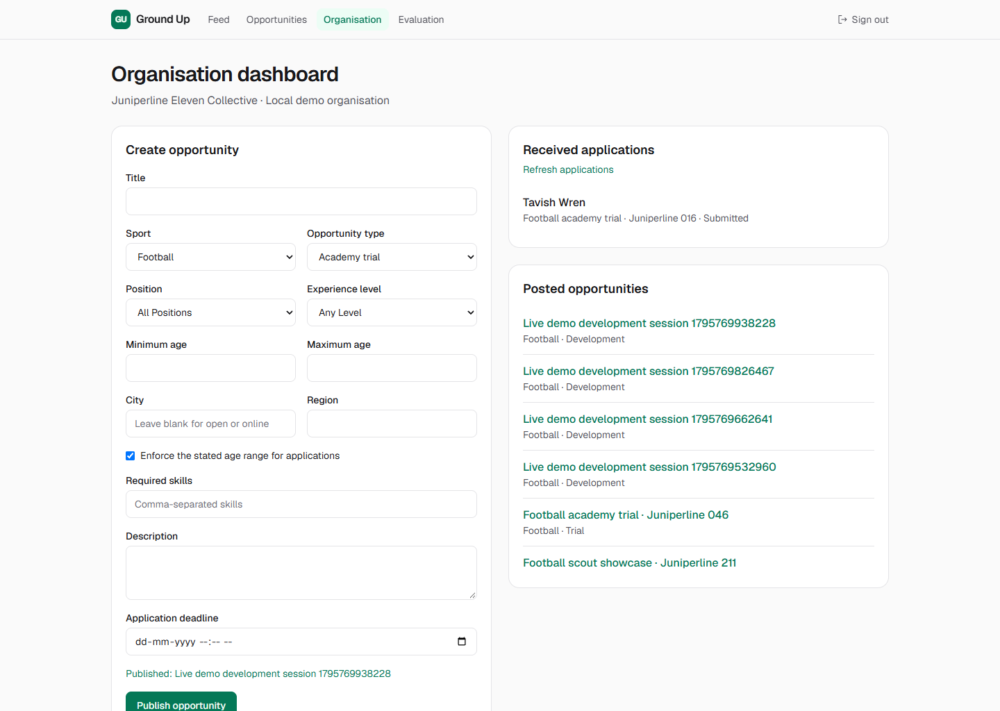
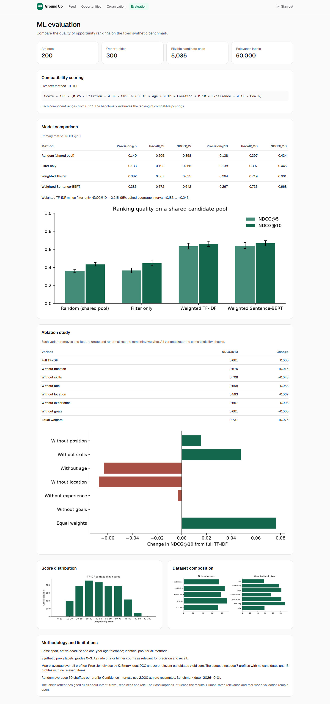

# Ground Up Sports AI Career Assistant

**CSET312 mini-project · AIML Semester 5 · December 2026**

**Team** Parikshit Dagar and Mehul Jakhmola

**Guide** Dr. Mala Saraswat

**School of Computer Science Engineering and Technology, Bennett University, Greater Noida, Uttar Pradesh, India**

The supplied PDF prints `E23CSEXXXX` as the enrollment placeholder for both students. The original submission documents are preserved in the repository.

## Abstract

Ground Up is an explainable sports career discovery application for athletes seeking trials, scholarships, tournaments, scouts, clubs and training. It filters opportunities by sport, age window and deadline, ranks the remaining items with six weighted components and gives athletes an explanation of every score. The system pairs a Next.js frontend with a FastAPI API and a PostgreSQL database. It supports persistent athlete profiles, organisation publishing, applications and a social feed. On the fixed synthetic benchmark of 200 athletes and 300 opportunities, weighted TF-IDF produced 0.6605 NDCG@10. The shared-pool deadline baseline scored 0.4456, random ordering scored 0.4339 and the CPU Sentence-BERT variant scored 0.6684. These measures reflect ranking against synthetic proxy labels.

## Problem and objectives

Grassroots athletes often discover listings through local contacts, social media and word of mouth. Search by sport or location leaves them to assess the requirements individually, while organisations have to sift through applications. The project aims to structure athlete and opportunity information, personalise discovery, explain compatibility, support a durable application workflow and measure ranking quality reproducibly. A compatibility score concerns stated opportunity requirements. Selection decisions belong to the organisation.

## Literature review

Lops, de Gemmis and Semeraro describe matching item content to a user profile. That approach fits a new platform because athlete attributes are immediately available. Schein et al. address challenges when users or items have limited interaction history. Burke reviews hybrids that combine signals. The supplied reports identify job recommendation as the closest analogy. Athletes and postings both have structured requirements, as do job seekers and vacancies.

The reports distinguish scouting and video analytics tools from athlete-facing opportunity discovery. Decroos et al. study valuing player actions. Ground Up addresses which listings an athlete might pursue. TF-IDF follows the term-weighting approach discussed by Salton and Buckley. Reimers and Gurevych’s Sentence-BERT provides dense sentence embeddings for paraphrases. Järvelin and Kekäläinen’s graded gains support the study’s primary ranking metric. The reports’ explanations literature motivates making score factors visible to the athlete.

## Architecture and implementation

The Next.js 16 web app retains the existing visual system and animated gallery. FastAPI validates profiles and postings, issues signed sessions and calls a pure Python matcher. PostgreSQL stores profiles, opportunity ownership, posts and applications, with an Alembic migration and a unique athlete/opportunity constraint. The organisation UI loads the user’s own listings and applications. The local demo uses fictional seeded accounts. The API records document type and pending status for identity requests.

[System architecture and data flow](../ARCHITECTURE.md) · [API contracts](API_DOCUMENTATION.md)

## Dataset and preprocessing

The generator creates 200 athletes, 300 opportunities in five sports, 15 organisations, 50 social posts and 60,000 synthetic pair labels. Seeds 7 and 42 control athlete and posting data. The exported evaluation timeline is fixed to 2026-10-01 UTC. The database seed uses relative deadlines for the live demonstration. Fixtures include age boundary cases, expired and rolling listings, related positions, partial skill overlap, paraphrases and profiles without eligible options.

Input validation checks ranges and lengths. Unicode normalization, case folding, whitespace collapse and position or skill aliases standardise categories. Binary skill vectors compute set cosine similarity. Ordered experience categories preserve one-step proximity. TF-IDF fits one vocabulary on active descriptions and transforms both posting text and athlete goals in that space. Missing text uses a neutral component score, and empty vocabulary or unseen terms contribute zero lexical overlap. The optional model encodes just the goals and descriptions with a cached CPU MiniLM encoder.

[Dataset and annotation rubric](DATASET.md) · [Preprocessing and model specification](ML_METHODOLOGY.md)

## Mathematical formulation

```text
Score = 100 × (0.25 Position + 0.30 Skills + 0.15 Age
             + 0.10 Location + 0.10 Experience + 0.10 Goals)
```

The components range from 0 to 1. Position uses exact and related matches. Skills and goals use cosine similarity. Age uses strict fit or one-year tolerance, location uses city and region and experience uses ordered levels. Candidate gating requires the same sport, an open posting and the permitted age window. A tolerance-band listing with a hard age limit cannot receive an application. The historical hand calculation remains a test and yields 93.5.

## Experimental setup and results

All methods use identical eligible candidates. The random model averages 50 shuffles per athlete, and filter-only sorts active eligible postings by nearest deadline. Precision and recall use grades 2 and 3 as relevant. NDCG uses linear graded gain. The macro average includes all 200 profiles, including seven without candidate matches and 16 without a grade 2 or 3 item in their pool. The candidate pools contained 5,035 pairs. Intervals use 2,000 bootstrap resamples drawn at the athlete level.

| Method | Precision@5 | Recall@5 | NDCG@5 | Precision@10 | Recall@10 | NDCG@10 |
|---|---:|---:|---:|---:|---:|---:|
| Random | 0.1405 | 0.2051 | 0.3585 | 0.1377 | 0.3966 | 0.4339 |
| Filter only | 0.1330 | 0.1919 | 0.3664 | 0.1380 | 0.3970 | 0.4456 |
| Weighted TF-IDF | 0.3820 | 0.5674 | 0.6350 | 0.2635 | 0.7189 | 0.6605 |
| Weighted Sentence-BERT | 0.3850 | 0.5718 | 0.6418 | 0.2670 | 0.7349 | 0.6684 |

The NDCG@10 difference between weighted TF-IDF and the filter-only baseline was +0.2149, with a 95% paired interval of +0.1833 to +0.2459. The CPU semantic variant’s improvement over TF-IDF was +0.0078, with a paired interval of +0.0033 to +0.0125 under this proxy rubric. The application uses TF-IDF by default so the demonstration can run without model files.

### Feature ablation

The study removes one feature at a time, renormalizes remaining weights and retains all eligibility gates. Omitting location reduced NDCG@10 by 0.0672 and omitting the age score reduced it by 0.0629. Omitting skills raised it by 0.0477. The independent rubric uses entry skill presence only in some branches, while the live score gives skill cosine a 30% weight. This may help explain the mismatch. Removing goals had little effect for lexical matching, where much of the synthetic language uses paraphrases. Equal weights scored 0.7369 and the median over 300 random weight vectors was 0.6850. The reference weights remain fixed for the app and need independently annotated data before tuning.

[Executed tables and interpretation](../evaluation/evaluation_report.md) · [Generated result JSON](../evaluation/results.json)

## Working application









[Five-minute demonstration](DEMO_GUIDE.md) · [Verification and mobile capture](TEST_REPORT.md)

## Limitations and future scope

The historical PDF used a different candidate-pool policy and relevance scale. This experiment re-runs the benchmark under a shared-pool protocol and does not reproduce the PDF’s numerical results. Relevance is independently coded but still correlates with some score features. Human annotation, contemporary real opportunity data, fair treatment across sports and regions, and validation against athlete outcomes are needed before applying results beyond the demonstration. Google OAuth still requires configuration. Real KYC, phone sign-in, hosted production infrastructure and supervised reranking remain future work.

## Conclusion

Ground Up shows that structured content, hard eligibility gates and explainable similarity can rank relevant synthetic sports opportunities above simple baselines. Profile edits affect the actual API results, and successful applications reach an organisation inbox through the database. The generated metrics and ablations make the strengths and limitations of the synthetic evaluation inspectable.

## References

1. Ground Up M2 milestone, Sections 1–8. [Source HTML](../Report/AI%20Career%20Assistant%2C%20M2%20Report%20%281%29.html)
2. Ground Up CSET312 mini-project report, Chapters 1–5. [Source PDF](../Report/Ai%20Career%20Assistant.pdf)
3. Lops, de Gemmis and Semeraro. Content-based recommender systems. [Recommender Systems Handbook](https://link.springer.com/chapter/10.1007/978-0-387-85820-3_3)
4. Schein et al. Methods and metrics for cold-start recommendations. ACM SIGIR, 2002.
5. Burke. Hybrid recommender systems survey and experiments. User Modeling and User-Adapted Interaction, 2002.
6. Al-Otaibi and Ykhlef. A survey of job recommender systems. International Journal of Physical Sciences, 2012.
7. Decroos et al. Actions speak louder than goals. ACM SIGKDD, 2019.
8. Salton and Buckley. Term-weighting approaches in automatic text retrieval. Information Processing & Management, 1988.
9. Reimers and Gurevych. Sentence-BERT. [ACL Anthology](https://aclanthology.org/D19-1410/)
10. Järvelin and Kekäläinen. Cumulated gain-based evaluation of IR techniques. ACM TOIS, 2002. [DOI](https://doi.org/10.1145/582415.582418)
11. Sentence Transformers. all-MiniLM-L6-v2 model card. [Hugging Face](https://huggingface.co/sentence-transformers/all-MiniLM-L6-v2)
