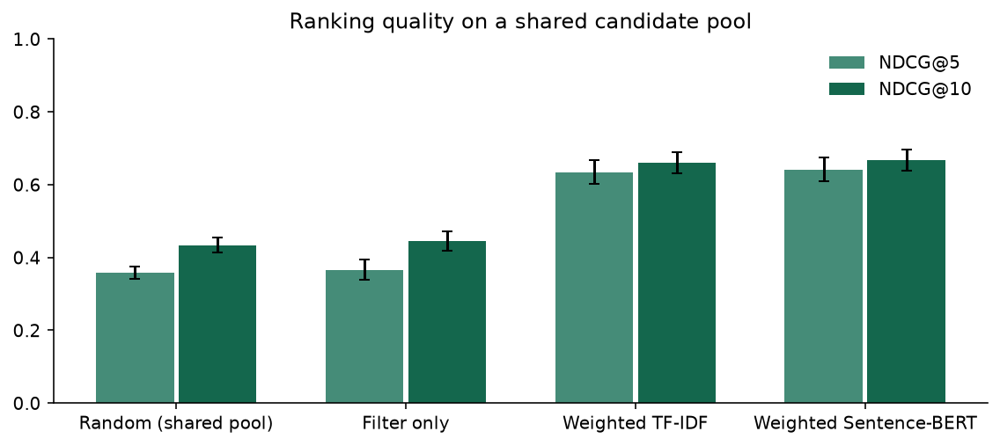
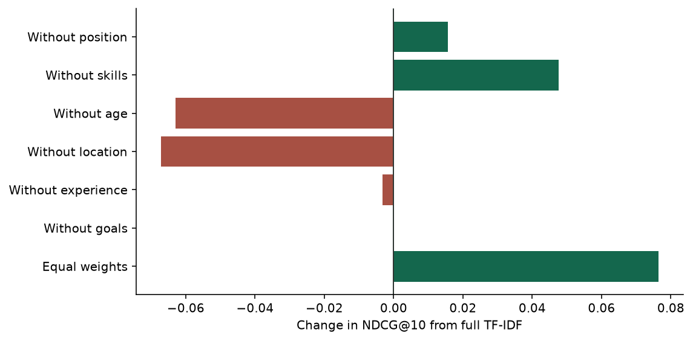
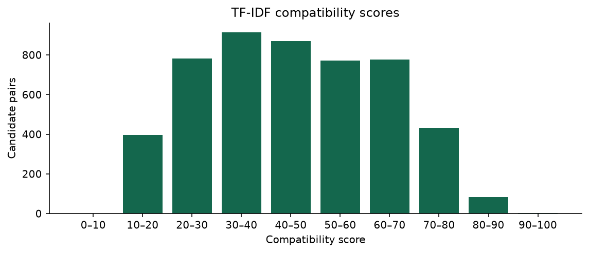
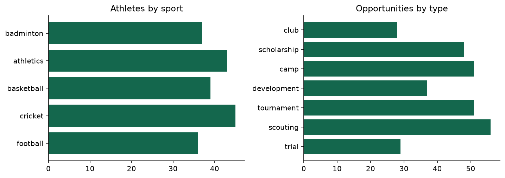

# Ground Up ranking evaluation

All numbers were generated by this runner. The 200 synthetic profiles share candidate pools across methods. There were 5,035 candidate pairs, 7 profiles with no candidates and 16 profiles without a grade of 2 or 3 in their pool.

## Baselines and model comparison

| Method | Precision@5 | Recall@5 | NDCG@5 | Precision@10 | Recall@10 | NDCG@10 |
|---|---:|---:|---:|---:|---:|---:|
| Random (shared pool) | 0.1405 | 0.2051 | 0.3585 | 0.1377 | 0.3966 | 0.4339 |
| Filter only | 0.1330 | 0.1919 | 0.3664 | 0.1380 | 0.3970 | 0.4456 |
| Weighted TF-IDF | 0.3820 | 0.5674 | 0.6350 | 0.2635 | 0.7189 | 0.6605 |
| Weighted Sentence-BERT | 0.3850 | 0.5718 | 0.6418 | 0.2670 | 0.7349 | 0.6684 |

The paired TF-IDF minus filter-only NDCG@10 difference is +0.2149 with a 95% athlete bootstrap interval from +0.1833 to +0.2459. Sentence-BERT status is `evaluated`.

The paired Sentence-BERT minus TF-IDF NDCG@10 difference is +0.0078 with a 95% interval from +0.0033 to +0.0125.

## Ablation and sensitivity

| Method | Precision@5 | Recall@5 | NDCG@5 | Precision@10 | Recall@10 | NDCG@10 |
|---|---:|---:|---:|---:|---:|---:|
| Full TF-IDF | 0.3820 | 0.5674 | 0.6350 | 0.2635 | 0.7189 | 0.6605 |
| Without position | 0.3110 | 0.4839 | 0.6300 | 0.2405 | 0.6957 | 0.6762 |
| Without skills | 0.4090 | 0.6170 | 0.7075 | 0.2715 | 0.7512 | 0.7082 |
| Without age | 0.3460 | 0.5218 | 0.5521 | 0.2510 | 0.6978 | 0.5976 |
| Without location | 0.3560 | 0.5258 | 0.5529 | 0.2555 | 0.7009 | 0.5934 |
| Without experience | 0.3760 | 0.5500 | 0.6304 | 0.2600 | 0.7166 | 0.6573 |
| Without goals | 0.3820 | 0.5674 | 0.6350 | 0.2635 | 0.7189 | 0.6606 |
| Equal weights | 0.4020 | 0.6125 | 0.7187 | 0.2755 | 0.7746 | 0.7369 |

The lowest removal result is without location (-0.0672 NDCG@10). The highest removal result is without skills (+0.0477). Across 300 Dirichlet weight vectors, median NDCG@10 is 0.6850, with a range of 0.5103–0.8632. These experiments measure dependence on the proxy labels. The app keeps the report's design weights.

## Protocol and limitations

- Filter-only orders by nearest deadline, with rolling deadlines last and ID for ties. Random averages 50 shuffles per athlete. The recommender breaks score ties by ID.
- Precision divides by K even for short lists. Recall uses all the eligible grade 2–3 items for the athlete. NDCG uses the grade as linear gain and log2(rank + 1) discount. Zero denominators contribute zero. Averages weight all athletes equally.
- Bootstrap intervals resample whole athletes 2,000 times. They describe variation within this synthetic design.
- Labels are rule-based proxies with structured intent and travel preference. Their assumptions can favor or penalize specific scoring features. Independent human ratings and a representative sample of real opportunities are future work.

